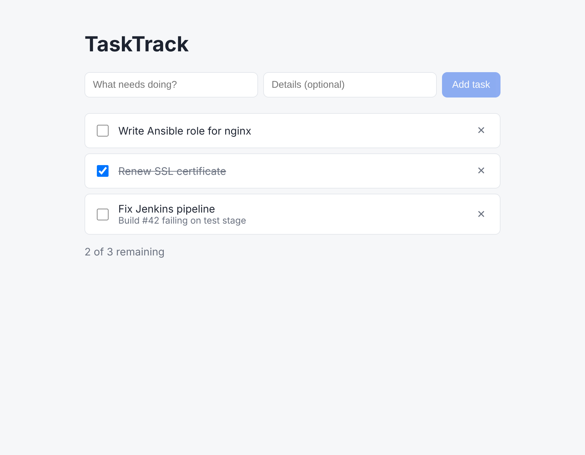

# Phase 2: Frontend (React + TypeScript)



## What a frontend actually is

The frontend is a bundle of HTML, CSS and JavaScript that gets **downloaded into the
user's browser and runs there**, not on your server. That has two big consequences:

1. **Users can see and change all frontend code.** Anyone can open browser dev tools and
   edit it. So the frontend can never enforce rules. It can only be *helpful*. The
   backend is the real enforcer.
2. **The frontend only shows things.** It gets data by sending HTTP requests to the
   backend, the same requests you made with curl in Phase 1.

## The tools

| Tool | What it is | Why |
|---|---|---|
| **React** | A library for building UIs out of *components* | You describe *what* the screen should look like for given data, and React works out what to redraw when the data changes. |
| **TypeScript** | JavaScript plus types | Catches errors like `task.titel` while you type, not in production. |
| **Vite** | Dev server + build tool | `npm run dev` reloads instantly on save. `npm run build` produces static files. |
| **npm** | Package manager | Like `pip` for JavaScript. `package.json` is your `requirements.txt`, and `package-lock.json` pins exact versions. |

## The files (read in this order)

```
frontend/
├── index.html            An empty page with <div id="root">. React fills it.
├── src/main.tsx          Mounts <App /> into that div.
├── src/types.ts          What a Task looks like (mirrors backend TaskOut).
├── src/api.ts            ★ THE BRIDGE: the only file that talks to the backend.
├── src/App.tsx           The main screen. Holds the task list in "state".
├── src/components/
│   ├── TaskForm.tsx      The "add task" form.
│   └── TaskItem.tsx      One row: checkbox, text, delete button.
└── src/styles.css        How it looks.
```

## Three React ideas you need

**1. Components** are functions that return what to draw. They look like HTML inside
JavaScript (that's called JSX):

```tsx
function TaskItem({ task }) {
  return <li>{task.title}</li>;
}
```

**2. Props** are inputs passed *down* from parent to child, like function arguments.
`App` passes `task` and `onDelete` to each `TaskItem`.

**3. State** is data that, when it changes, makes React redraw automatically:

```tsx
const [tasks, setTasks] = useState<Task[]>([]);
setTasks([...]);   // React redraws the list for you; no manual DOM editing
```

## How frontend and backend connect

This is the part you asked about. Here's what happens when you click **Add task**:

```
 BROWSER (localhost:5173)                         SERVER (localhost:8000)
 ─────────────────────────                        ───────────────────────
 TaskForm: user clicks "Add task"
   → App.handleCreate(title)
     → api.createTask(title)
       → fetch("http://localhost:8000/tasks",
               { method: "POST",
                 body: '{"title":"..."}' })  ───HTTP──►  FastAPI create_task()
                                                          → validates, saves to Postgres
                                             ◄──JSON───  201 {"id":4,"title":"...",...}
     ← returns the new Task object
   → setTasks([newTask, ...tasks])
 React redraws the list ✓
```

The "contract" between the two sides is the JSON shape. `types.ts` on the frontend and
`schemas.py` on the backend must agree. Keeping that in sync is a real-world pain, and
larger teams generate one from the other.

## CORS: why the browser blocked us at first

The frontend runs at `localhost:5173` and the API at `localhost:8000`. Different port
means a different **origin** to the browser. By default, browsers **block** JavaScript
from reading responses from another origin.

**Why that rule exists:** without it, any website you visit (evil.com) could run
JavaScript that calls `yourbank.com/api/transfer`, and your browser would send your
bank cookies along.

**The fix:** the backend tells the browser which origins it trusts. Look at
`CORSMiddleware` in `backend/app/main.py`, with the allowed list coming from
`CORS_ORIGINS` in `.env`. An unlisted site gets no permission header, so the browser
refuses to hand over the response.

> CORS is enforced **by browsers only**. curl, Postman and scripts ignore it. It protects
> *users* from malicious sites. It is **not** access control for your API. That's
> Phase 3 (logins).

## Security in this phase

- **XSS (Cross-Site Scripting) is blocked by default.** If someone saves a task titled
  `<script>alert(1)</script>`, React displays it as text and doesn't run it. The one way
  to break this is React's `dangerouslySetInnerHTML`. The name is the warning.
- **Frontend validation is a convenience, not security.** `maxLength={200}` on the input
  only helps honest users. An attacker skips the UI and calls the API with curl. The
  backend schema is what actually stops them.
- **Never put secrets in frontend code.** Everything in the bundle, including every
  `VITE_*` variable, is visible to anyone. The API URL is fine. An API key or database
  password is not.

## Run it

**Option A: everything in Docker (closest to production)**

```bash
cp .env.example .env
docker compose up --build
```

Open http://localhost:3000

**Option B: frontend dev server (best while coding; reloads on every save)**

```bash
docker compose up db backend
```

In a second terminal:

```bash
cd frontend
npm install
npm run dev
```

Open http://localhost:5173

## DevOps corner: the frontend Dockerfile

`frontend/Dockerfile` is a **multi-stage build**. Stage 1 uses Node to compile
TypeScript into plain JS files. Stage 2 copies only those files into a small nginx
image. The final image has no Node, no source and no `node_modules`, which means a
smaller image and less to attack. You'll use this same pattern for Go, Java and others.

## Exercises

1. **Watch the network.** Open the app, press F12 → *Network* tab, add a task. Click the
   `tasks` request and look at the method, the status code (201), the request body and
   the response JSON. This is the frontend-backend connection, live.
2. **Break CORS on purpose.** Change `CORS_ORIGINS` in `.env` to only
   `http://localhost:9999`, restart the backend, and reload the page. Read the red CORS
   error in the browser console. Then put it back.
3. **Prove frontend validation isn't security.** Use curl to POST a title of 300
   characters. Which side rejects it?
4. **Add a feature through both layers.** Show each task's `created_at` as a date under
   the title. Hint: `new Date(task.created_at).toLocaleDateString()` in `TaskItem.tsx`.
5. **Stretch:** if you did the `priority` exercise from Phase 1, add a dropdown for it in
   `TaskForm` and show it in `TaskItem`. That's a full-stack feature: database → API → UI.
